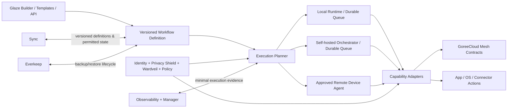

# GoreeCloud Automations — proposed tenth Integral Platform System

**Draft architectural proposal; verified system inventory currently has nine adopted Integral Platform Systems.** GoreeCloud's `Instructions — Integral Platform Systems.docx` and current integral-system decision record must be deliberately amended through the governed process before a ten-system model is designated adopted. This file is not an amendment to that authority.

## Product promise

Build once, execute wherever safely possible: locally on a phone, tablet, laptop, desktop, television, server, browser, home hub, or authorized remote agent. When offline, use only device capabilities that work without network; queue remote work only if the workflow author has allowed it; resume after connectivity and authorization checks. Never imply that an offline-capable workflow can perform a cloud-only step offline.

Three complementary creation surfaces share the same versioned workflow contract:

1. **Quick automation** — human-readable trigger/action wizard and editable recipes (Shortcuts / IFTTT ease).
2. **Visual Studio** — Glaze node graph, variables, conditions, branches, parallel paths, loops, subflows, retries, schedule previews (n8n / Zapier power).
3. **Code / AI** — optional typed expressions and tested script sandboxes; GoreeCloud AI can generate *draft* flows, simulate, and explain them, but a user/administrator grants permissions and activates them.

## Execution planes



**Ownership boundary:** Automations owns workflow compilation, execution state, schedules, triggers, action references, retries, approvals, pause/resume and user-visible run explanations. Mesh owns discovery and event routing; Sync owns cross-device definitions/state replication; Manager owns administration; Identity owns identity; Policy owns shared evaluation; Privacy Shield and Wardveil own privacy/security rules; Everkeep owns continuity; Observability owns operational health; Glaze owns the experience. GoreeCloud AI drafts and analyzes but cannot grant itself action privileges. Notify delivers notifications, not workflow orchestration.

## Cross-device capabilities and honest limits

| Runtime | Intended execution | Boundary |
|---|---|---|
| Android phone/tablet, Android/Google TV | Native Kotlin adapter + embedded portable engine; WorkManager/OS-sanctioned tasks; remote/navigation intents where supported | Doze, vendor restrictions, foreground service permissions, and TV launcher limitations are respected; no promise of exact background time |
| iPhone/iPad | Swift App Intents, share sheet, widgets, background-task bridge + JS/WASM runtime | Only Apple-permitted app actions; unattended background and system automation are constrained by iOS lifecycle |
| macOS | Local agent, App Intents, native filesystem + notification adapters | Per-resource grants; user prompts for protected actions |
| Linux/Windows desktop | Sandboxed local daemon/agent with explicit capabilities | No arbitrary process/shell commands without trust policy and sandbox |
| Browser / PWA | Declarative engine inside active tab or installed PWA, service worker when available | Service workers do not provide an always-on scheduler or unrestricted OS access |
| tvOS and other limited TVs | Focus-driven remote UI for authoring/running appropriate actions; remote hub delegation | Many automation APIs / background tasks are unavailable; never claim full on-device parity |
| Self-hosted / cloud server | Durable scheduler and connector worker cluster with policy-aware run dispatch | Network-required actions cannot run without their remote dependency; secrets stay in the appropriate protected vault |

**Every action advertises capabilities, permission requirements, online/offline support, supported runtime, latency class, privacy purpose, reversibility, and delegation eligibility.** Cross-device delegation is opt-in, bound to verified identities and device capabilities, and reviewed with context-aware policy decisions at time of execution.

## Versioned workflow object (v1 foundation)

```json
{
  "id": "offline-morning", "version": 1, "name": "Morning check-in", "enabled": true,
  "triggers": [{ "type": "event", "name": "alarm.dismissed" }],
  "steps": [
    { "id": "save", "action": "local.note", "input": { "title": "Morning" } },
    { "id": "send", "action": "remote.send",
      "when": { "path": "payload.share", "op": "eq", "value": true } }
  ]
}
```

Current engine is linear and event-triggered. Planned v2 adds typed directed acyclic graphs, schedule/cron and device/geo triggers, flow inputs and outputs, fan-out/fan-in, loops with quotas, secrets references, retries with exponential backoff, cancellation and compensation, environment pinning, schema migration, and dry-run simulations. **Do not silently treat proposed v2 syntax as implemented.**

## Operational delivery guarantees

- Local durable event inbox/outbox and durable run journal are required before offline execution is production-ready. This branch only supplies a MemoryStore reference and an atomic create-if-absent *interface*.
- At-least-once delivery to remote actions is an honest default; exactly-once effects require transaction support or resource-level idempotency. The engine generates a stable workflow:event:step key.
- The action boundary reauthorizes each step, including resumed steps; permission revocation must stop future execution. No elevated permission is inferred from the invoking trigger.
- Retries must use bounded attempts and backoff; poison events go to a reviewable dead-letter queue; high-risk actions need optional confirmation, compensation, or human approval.
- Offline execution must not silently delegate to cloud. Workflow authors see the placement decision and exact unsupported or deferred steps.
- Workflow definitions, local queues and secrets must be encrypted where appropriate. Store secret references, never credential values, in shareable/exported flow definitions.
- Runtime and plugin trust: signed capabilities/manifests, permission scopes, isolation/sandboxing, input schemas, output size caps, resource/time limits, update revocation, attack-surface testing.
- Telemetry is privacy-minimized and evidence-linked; the current engine emits sanitized status transitions without payloads.

## Accessibility and experience

Use actual Glaze tokens and components when available; do not imitate them via colors alone. Keyboard, touch, pointer, screen reader, dynamic type, reduced motion, high contrast, and TV D-pad navigation are functional acceptance criteria. The same workflow is representable as an accessible sequential editor even when the full graph cannot be shown on a small screen.

## First experiences worth making excellent

- On mobile: “At bedtime, enable my chosen scene, create a note, and queue tomorrow's task summary if I am offline.”
- On desktop: “When a download completes, rename, classify, save to my chosen folder, and notify my phone.”
- On TV: “Movie time” remote button dims approved devices and opens a media playlist.
- On server: “When an approved repository test fails, summarize failure context, create a task, and notify the right person.”
- Cross-device: “When I arrive home, run local actions now; hold remote tasks until the home hub comes online.”

All examples are **conceptual**, not live integrations in this branch.